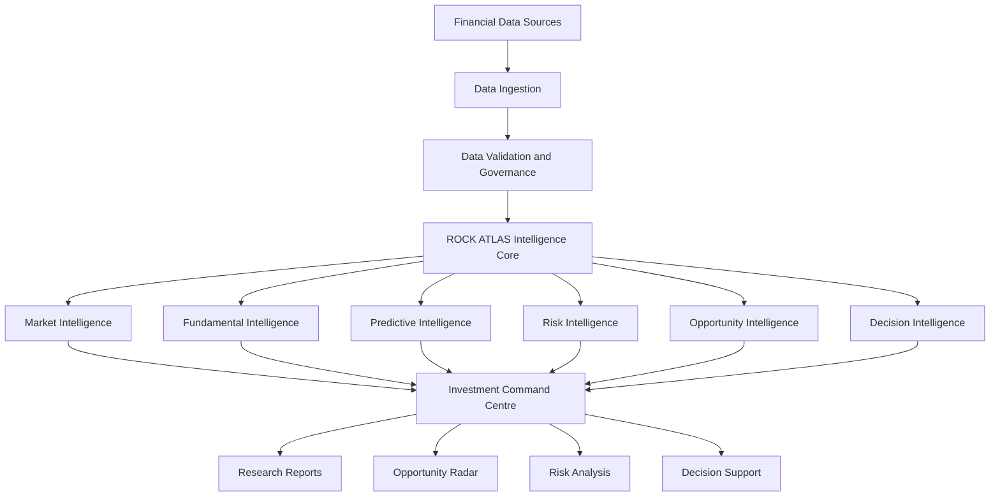

# ROCK ATLAS
### African Market Intelligence & Investment Decision Platform

**Research. Discover. Evaluate. Explain.**

---

> ### This repository is the merged build: ROCK ATLAS × Bedrock
>
> It joins the ROCK ATLAS platform with the **Bedrock** engine, which brings real Nairobi Securities Exchange data
> (2013 to 16 November 2026) and six models tested out of sample. Nothing was removed from either project.
>
> * **Every ROCK ATLAS workspace is kept and now runs on real NSE prices**, with a Bedrock block added to each.
> * **Bedrock's own pages are added**: Market Depth, Sell-off Alert, Crash Risk, Speculation Watch, Stress Test,
>   Market-Ready and Guide.
> * **The original MVP is preserved**: the eight workspaces on the synthetic corpus are cloned into the sidebar's
>   **Demo** group, and `src/App.tsx` is kept untouched beside the merged shell in `src/AppMerged.tsx`.
>
> Read [MERGE_PLAN.md](MERGE_PLAN.md) for what was agreed before the work, and [MERGE_LOG.md](MERGE_LOG.md) for
> what was actually done, including every conflict and how it was settled.
>
> ```bash
> npm install
> npm run dev                  # http://localhost:3000
> python export_for_atlas.py   # optional: rebuild public/data from Bedrock's pipeline
> ```
>
> The Bedrock engine itself lives in [bedrock/](bedrock/) (Python: pipeline, models, 16 tests, research note).

---

ROCK ATLAS is an AI-assisted financial intelligence platform designed to transform financial market data into transparent, explainable and actionable investment research.

Built initially around the Kenyan capital market and Nairobi Securities Exchange (NSE), ROCK ATLAS integrates financial data science, quantitative research, predictive analytics, risk modelling and interactive decision-support systems.

Our mission is to make African financial markets more understandable, accessible and intelligent.

---

## Vision

Financial markets do not suffer from a complete absence of information. They suffer from the difficulty of transforming fragmented information into reliable decisions.

ROCK ATLAS bridges this gap.

We are developing an integrated intelligence architecture that helps researchers and investors understand market behaviour, evaluate securities, identify potential opportunities, quantify risk and communicate financial insights through evidence-based analytical systems.

**Our guiding principle: Data should not merely be available. It should become useful.**

## Core Objectives

- Transform financial datasets into meaningful market intelligence.
- Develop transparent and reproducible quantitative research methodologies.
- Investigate investment opportunities across African capital markets.
- Improve financial risk assessment through statistical modelling.
- Apply machine learning responsibly to financial research.
- Make investment analysis more accessible through interactive software.
- Establish an extensible foundation for African financial intelligence infrastructure.

---

## Intelligence Architecture

ROCK ATLAS is organized around six interconnected intelligence engines.

| Engine | Purpose |
|---|---|
| Market Intelligence | Analyse market movements, trends, trading activity and sector performance. |
| Fundamental Intelligence | Examine company financial performance, fundamentals and valuation metrics where data permits. |
| Predictive Intelligence | Investigate market patterns through statistical modelling, forecasting and backtesting. |
| Risk Intelligence | Evaluate volatility, drawdowns, correlations and portfolio risk. |
| Opportunity Intelligence | Screen, compare and rank securities using transparent analytical frameworks. |
| Decision Intelligence | Convert analytical results into explainable research insights and reports. |

### System Architecture



---

## Flagship Innovations

### 1. African Investment Opportunity Radar

An analytical screening and comparative research system for identifying potentially interesting securities.

The Opportunity Radar evaluates multiple dimensions:

| Intelligence Dimension | Initial Proposed Weight |
|---|---:|
| Market Momentum | 20% |
| Financial Fundamentals | 25% |
| Relative Valuation | 20% |
| Risk Profile | 20% |
| Liquidity | 15% |
| **Total** | **100%** |

These are illustrative starting weights, not validated investment rules. The framework is designed to support configurable weighting, sensitivity analysis and empirical evaluation.

Each assessment should explain:

- The factors contributing to its score.
- Supporting financial evidence.
- Identified risks.
- Missing information.
- Sources of uncertainty.
- Conditions that could invalidate the assessment.

The system provides analytical research support, not automatic buy or sell instructions.

### 2. Kenyan Market Resilience Index (KMRI)

An experimental research framework investigating the resilience of securities listed on the Nairobi Securities Exchange.

Proposed dimensions:

| Dimension | Measurement |
|---|---|
| Performance | Historical returns |
| Resilience | Maximum drawdown and recovery |
| Stability | Realized volatility |
| Liquidity | Trading volume and turnover |
| Market Participation | Foreign turnover, where available |

The objective is to investigate which securities demonstrate stronger combinations of performance, stability, liquidity and resilience during different market conditions.

All scoring methodologies require empirical testing and validation.

### 3. Investment Command Centre

An interactive financial intelligence environment bringing together:

- Market overview.
- Opportunity screening.
- Individual security analysis.
- Risk laboratory.
- Predictive analytics.
- Portfolio simulations.
- Market resilience analysis.
- Research reporting.
- Data and model governance.

---

## Technology Stack

| Technology | Application |
|---|---|
| Python | Core programming and analytics |
| Pandas | Financial data manipulation |
| NumPy | Numerical computation |
| Scikit-learn | Machine learning experiments |
| Statsmodels | Statistical modelling |
| Plotly | Interactive data visualization |
| Streamlit | Interactive application |
| SQLite | Lightweight data storage |
| Jupyter Notebook | Research and experimentation |

An optional large language model integration may assist with research explanations and report generation. AI-generated explanations must remain grounded in verified analytical outputs.

---

## Project Structure

```text
rock-atlas/
│
├── app.py
├── requirements.txt
├── README.md
│
├── config/
│   └── settings.py
│
├── data/
│   ├── raw/
│   ├── processed/
│   └── synthetic/
│
├── src/
│   ├── ingestion/
│   ├── validation/
│   ├── market_intelligence/
│   ├── fundamental_intelligence/
│   ├── predictive_intelligence/
│   ├── risk_intelligence/
│   ├── opportunity_intelligence/
│   ├── decision_intelligence/
│   └── backtesting/
│
├── models/
│
├── notebooks/
│
├── research/
│   └── RESEARCH_TEMPLATE.md
│
├── reports/
│
├── tests/
│
└── assets/
```

The structure represents the intended modular architecture. Directories and modules should be added as their corresponding functionality is implemented.

---

## Getting Started

### Requirements

- Python 3.10 or later.
- pip.
- Git.
- A compatible desktop or laptop environment.

### 1. Clone the Repository

```bash
git clone https://github.com/ObiwanKenobee/rock-atlas.git
```

### 2. Enter the Project Directory

```bash
cd rock-atlas
```

### 3. Create a Virtual Environment

```bash
python -m venv .venv
```

Activate it:

**macOS / Linux**

```bash
source .venv/bin/activate
```

**Windows**

```bash
.venv\Scripts\activate
```

### 4. Install Dependencies

```bash
pip install -r requirements.txt
```

### 5. Launch the Application

```bash
streamlit run app.py
```

The application should open in your browser at:

```text
http://localhost:8501
```

---

## Data Sources and Integrity

ROCK ATLAS is designed to use verified financial datasets, beginning with Rock Data Plus and relevant NSE market information where access and permitted usage allow.

Potential data categories include:

- Historical equity prices.
- Trading volumes.
- Market turnover.
- Foreign investor activity.
- Company financial statements.
- Macroeconomic indicators.
- Sector performance indicators.

Every dataset must have documented provenance, historical coverage, units, data dictionary and usage permissions.

### Data Classification

| Classification | Description |
|---|---|
| Verified | Obtained from a traceable source and validated. |
| Synthetic | Artificial data used for testing and demonstration. |
| Estimated | Derived through a documented estimation methodology. |
| Unavailable | Not yet obtained or verified. |

**Important:** Demonstration datasets must never be represented as actual NSE market observations. Research findings must be based on appropriately verified source data.

---

## Quantitative Research Standards

Research conducted through ROCK ATLAS should prioritize reproducibility and methodological transparency.

Key requirements include:

- Chronological training and testing.
- Avoidance of look-ahead bias.
- Consideration of survivorship bias.
- Transaction cost assumptions.
- Liquidity constraints where relevant.
- Benchmark comparisons.
- Walk-forward validation where appropriate.
- Model performance evaluation.
- Sensitivity analysis.
- Explicit documentation of uncertainty.

Historical performance is not a guarantee of future results.

---

## Development Roadmap

| Phase | Development Focus | Status |
|---|---|---|
| 01 | Project foundation and prototype | Initial prototype |
| 02 | Financial data ingestion and validation | Planned |
| 03 | Market Intelligence Engine | Planned |
| 04 | Opportunity Radar | Initial framework |
| 05 | Risk Intelligence Laboratory | Planned |
| 06 | Predictive Intelligence | Planned |
| 07 | Kenyan Market Resilience Index | Research framework |
| 08 | Decision Intelligence and reporting | Planned |
| 09 | Comprehensive testing and validation | Planned |
| 10 | Expanded African market coverage | Future vision |

The roadmap describes intended development, not a claim that every component is currently implemented.

---

## Research Opportunities

ROCK ATLAS creates opportunities for further research into:

1. Quantitative analysis of Kenyan capital markets.
2. Historical market behaviour and resilience.
3. Financial data quality and accessibility.
4. Explainable machine learning in investment research.
5. Risk modelling in emerging markets.
6. Sector performance and macroeconomic relationships.
7. Financial intelligence infrastructure for African markets.

Researchers, developers, data scientists and financial professionals can contribute to the development of these areas.

---

## Contributing

We welcome collaboration around financial analytics, software engineering, quantitative research, data science and financial technology.

Potential contributions include:

- Improving financial data ingestion.
- Developing new analytical methods.
- Testing statistical models.
- Improving risk calculations.
- Building visualizations.
- Enhancing research documentation.
- Writing automated tests.
- Improving accessibility and usability.

### Contribution Guidelines

1. Fork the repository.
2. Create a feature branch.
3. Document your proposed changes.
4. Include tests for analytical calculations.
5. Ensure financial data sources and assumptions are traceable.
6. Submit a pull request explaining your contribution.

All contributions should prioritize reproducibility, transparency and responsible financial analysis.

---

## Responsible Use

ROCK ATLAS is an experimental financial research and decision-support project.

It does not constitute personalized investment advice, an offer to trade securities or a guarantee of investment performance.

Analytical scores, model outputs and forecasts should be interpreted in context, with appropriate consideration of their assumptions, limitations and uncertainty.

Users remain responsible for independent research and investment decisions.

---

## Long-Term Vision

ROCK ATLAS is intended to become the foundation of a broader African Financial Intelligence architecture.

Future possibilities include:

- Multi-country capital market intelligence.
- African company intelligence knowledge graphs.
- Macroeconomic research systems.
- Institutional investment research tools.
- Explainable AI-powered financial analysis.
- Open financial research infrastructure.
- Developer APIs and collaborative research tools.

We envision a future where African financial information can be transformed into accessible intelligence that supports better research, deeper market understanding and more informed economic participation.

---

## Acknowledgements

Built around the research and financial data opportunities provided by Rock Data Plus, with an initial focus on the Kenyan capital market.

This project is an independent innovation and research initiative. It should not be interpreted as an official product, endorsement or institutional partnership with Rock Investment Bank unless such a relationship is formally established.

---

## License

Choose and publish an appropriate open-source license before accepting external contributions or distributing the project.

---

**ROCK ATLAS**

*African Market Intelligence & Investment Decision Platform.*

**Research. Discover. Evaluate. Explain.**

**Building financial intelligence for Africa's next generation of markets.**
