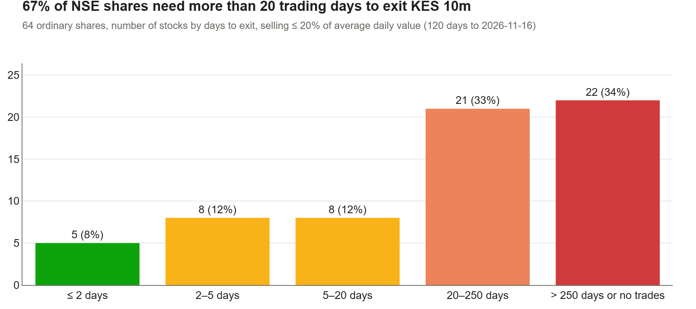
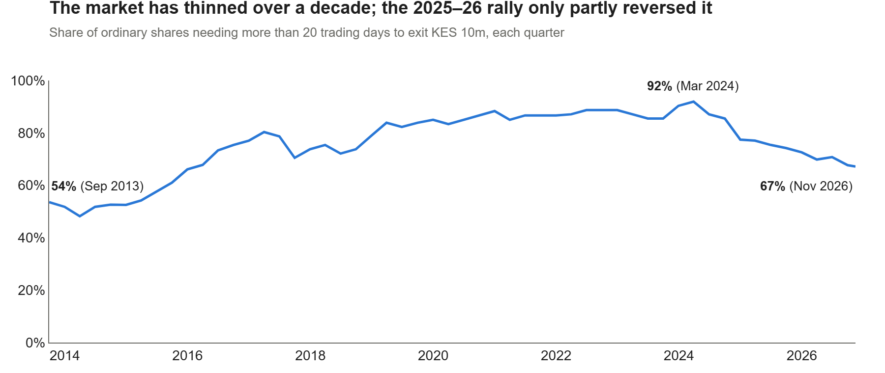
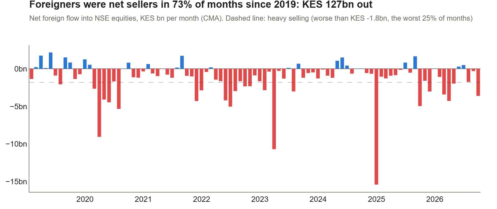
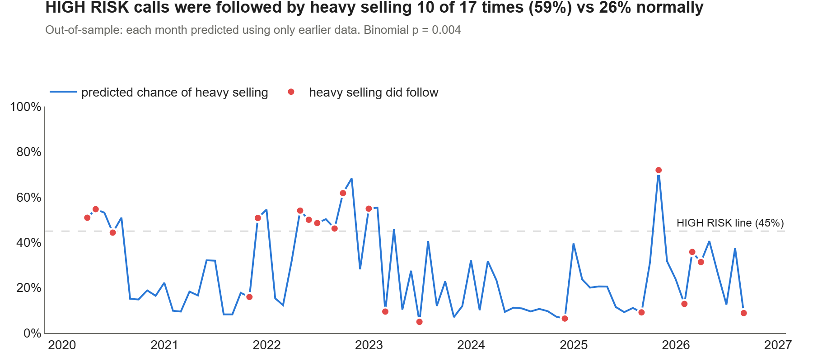
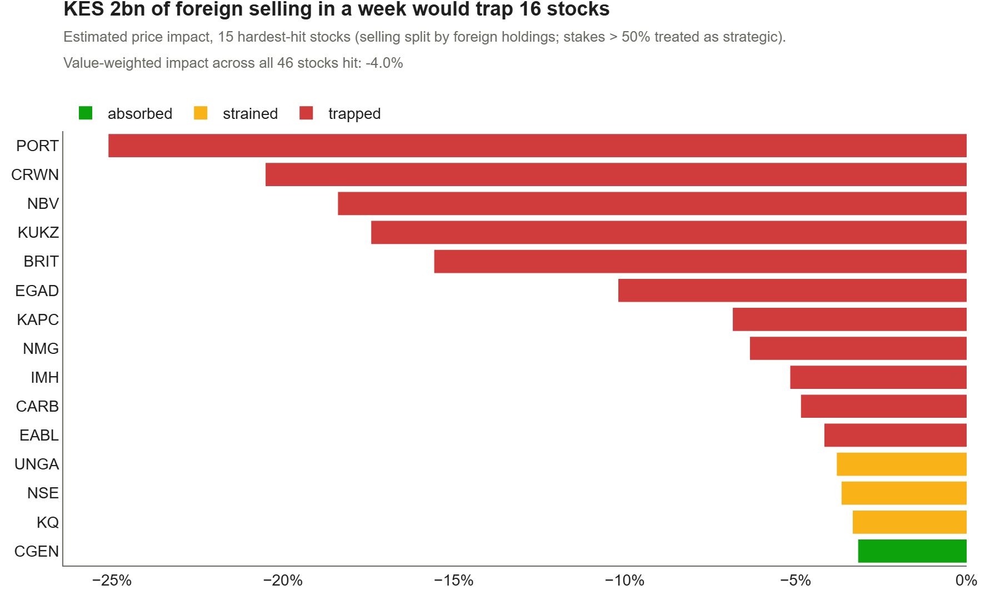
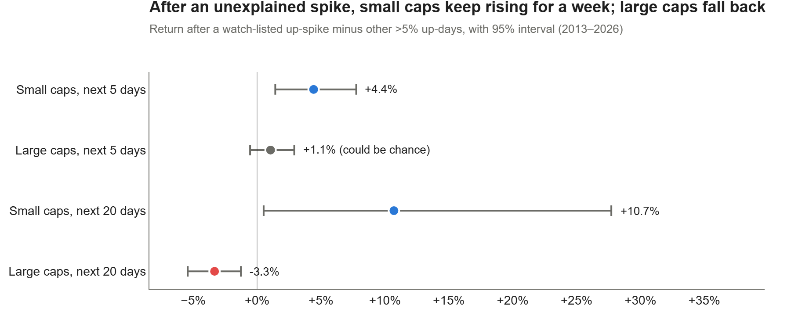
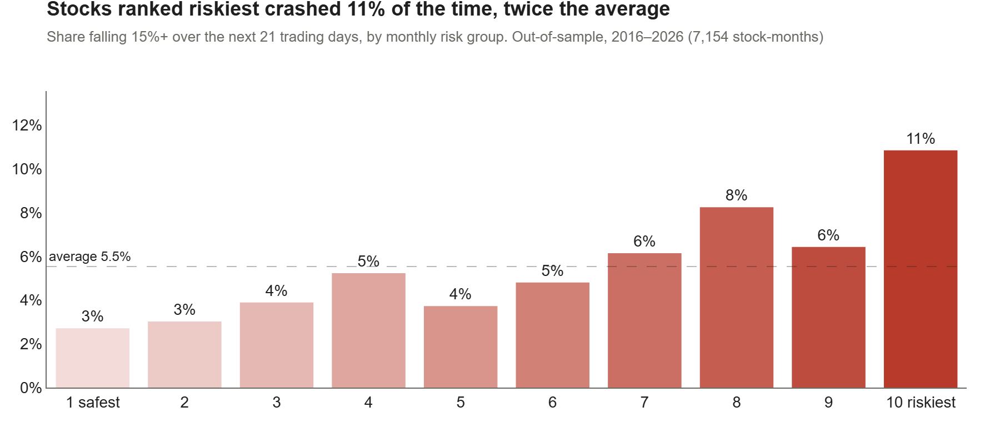

# Bedrock: what really holds up the NSE rally?

*Research note · market data to 16 Nov 2026, foreign flows to Sep 2026 · code: github.com/&lt;your-account&gt;/bedrock*

## Headline

**The NSE is near record highs, but 67% of listed shares would take more than 20 trading days to exit a KES 10m position, and foreigners have been selling into the rally.** Our early-warning model's HIGH RISK calls were followed by heavy foreign selling 59% of the time, against 26% normally. It reads HIGH RISK for October 2026.

| | |
|---|---|
| **67%** | of 64 ordinary shares need more than 20 trading days to exit KES 10m (selling at most 20% of daily trading) |
| **74%** | of all value traded is in just five stocks |
| **KES 127bn** | net foreign selling since 2019: foreigners were net sellers in 73% of months, through the rally |
| **16** | stocks would be trapped by KES 2bn of foreign selling in one week, including Equity Group |
| **59% vs 26%** | how often HIGH RISK warnings were followed by heavy foreign selling, against a normal month (10 of 17 calls, p = 0.004) |

## 1. How shallow is the market?

For each stock we ask a fund manager's question: *if I hold KES 10m, how many trading days does it take to sell without being more than a fifth of the market?* That is the position divided by 20% of the stock's average daily value traded over the last 120 trading days. One-off block deals, such as NCBA's KES 100bn single-day transfer of two-thirds of the company on 3 Nov 2026 and Kenya Pipeline's KES 41bn block on 19 Oct, are capped, because an ordinary seller cannot use that liquidity.

Only five stocks can be exited within two days. Safaricom, Equity and KCB clear KES 10m in under half a day, followed by DTB and Co-op Bank. At the other end, 22 stocks (34%) need more than a year or did not trade at all, and 11% of ordinary shares had no trades in six months. Five stocks make up 74% of value traded.

The market thinned for a decade. The share of stocks needing more than 20 days rose from 54% in 2013 to a peak of 92% in March 2024. The 2025–26 rally brought it down to 67%, still far thinner than in 2013. **The rally has lifted prices much more than it has deepened the market.**

*Robustness:* at KES 10m the figure stays between 62% and 72% across lookbacks of 60–250 days and participation of 10–30%. At KES 1m it is 33–53%; at KES 50m, 73–94%. It barely depends on the block-deal cap: 66–67% with caps from 5× to 50× the normal day, and 62% with no cap at all. The cap matters mainly for the top-5 share (70–82%).

## 2. When will foreigners sell?

Foreigners own a large share of the NSE's liquid stocks. They were net sellers in 73% of months since 2019, a net KES 127bn out, and kept selling through the 2025–26 rally: local investors carried it. A month of *heavy* selling is one in the worst quarter of net flows, with the threshold re-set each month using only past data (currently a net outflow of about KES 1.8bn).

We tested every model honestly: each month it is retrained using only data available then, and it predicts the following month (78 test months). We compared three input sets (flows only; flows plus Kenyan and global macro; plus market activity) and two models (logistic regression and XGBoost), and we report every combination in the dashboard. **The simplest version won.** XGBoost on foreign flows alone (this month and the last three) is the only one that beats simply quoting the normal rate. Adding macro inputs made it worse: with about 140 monthly data points, extra inputs add noise, not signal.

- **HIGH RISK calls were followed by heavy selling 10 of 17 times (59%), against 26% normally.** p = 0.004, or 0.023 after correcting for the six model versions tried.
- It does not depend on where the line is drawn: a HIGH RISK line anywhere from 35% to 50% gives hit rates of 52–59% (all p < 0.03).
- It is well calibrated at the top: when it says about 54%, heavy selling followed 59% of the time. Its Brier score beats the normal rate by 9%.
- A no-model rule ("this month was already heavy selling") hits only 40% (p = 0.12), so the model adds something beyond "selling continues".
- **Limits, stated plainly.** It catches about half of heavy-selling months (10 of 20), and most of its hits came in long exit waves (2020 and 2022). Recently it has done worse: from July 2025 to September 2026 it caught 1 of 6 heavy months, because selling that starts from a calm month is hard to see in monthly data. Its overall ranking (AUC 0.64) is no better than tracking the running base rate, and low readings are no all-clear: heavy selling followed 21% of them. So the dashboard shows only **HIGH RISK** or **NO CALL**, never "low risk".

**Current reading (October 2026): 53%, HIGH RISK**, driven by September's KES 3.6bn net outflow (KES 5.7bn over three months).

The biggest upgrade is **weekly or daily foreign buy/sell data from Rock Data Plus**: about four times more data points and earlier warnings. The code detects the frequency and re-tests itself without changes. With more data, the macro inputs may start to help.

## 3. Where does it break? Stress test

What happens if foreign investors sell KES 2bn in one week? We split the selling across stocks by foreign-held value (CMA shareholding data). Stakes above 50% are treated as strategic parents that would not sell. We then estimate how long each stock needs to absorb its share at 20% of daily trading, and the price impact with the standard square-root law (volatility × √(amount sold ÷ average daily value)).

- **46 stocks are hit; 16 are trapped**: they need more than four weeks to absorb the selling, or have no market at all.
- **Even Equity Group, one of the NSE's two most liquid stocks, is trapped.** Foreigners own 41% of it, so it takes KES 856m of the selling. At 20% of its daily trading that needs 22 trading days, although the price impact stays small (about −3%).
- The real damage is in mid and small caps: Portland Cement (−25%), Crown Paints (−21%), NBV (−18%), Kakuzi (−17%) and Britam (−16%), where the selling would take months to clear.
- The value-weighted impact across all stocks hit is only −4.0%. **The index would look calm while many smaller stocks become unsellable.**

## 4. Speculation in thin stocks

We flag stock-days where price and volume both break sharply from the stock's own previous 60 days while the market as a whole did not move (an Isolation Forest on standardized returns and volume). A flag is a *lead*, checked by hand against announcements and the press.

Across 2013–2026, after a watch-listed up-spike, compared with other days that rose more than 5% (95% intervals resample whole stocks):

- **Small caps keep rising for about a week:** +4.4% over 5 days (interval +1.4% to +7.8%), and +10.7% over 20 days, though that interval (+0.5% to +27.7%) only just excludes zero. This momentum fits pump-style trading in thin stocks.
- **Large caps partly reverse:** −3.3% over 20 days (interval −5.4% to −1.3%).

**The hand checks matter.** We checked 21 of the most unusual days from 2025–26. Twelve had a clear explanation: Kenya Airways' return to trading and its USD 350m government loan, Diageo's sale of EABL to Asahi, the Aga Khan Fund's sale of Nation Media, results or dividends at Car & General, Williamson and Kapchorua, and a global-equity ETF tracking world markets. The model finds real events. **Nine had no news we could find.** These are the leads: speculation or undisclosed block deals.

- **Worked example 1: TransCentury (TCL), Jan–Feb 2025 (no news).** TCL normally traded about KES 64,000 a day. From 20 January it rose on 12 of the next 13 trading days, from KES 0.50 to 1.65 (+230%), on 10–100 times its usual value traded (up to KES 6.6m a day), then fell 39% in five days. We found no announcement or press coverage behind the run. Bedrock flagged it on the second day.
- **Worked example 2: Car & General, 2026 (news, with speculation on top).** Bedrock flagged C&G in April (results, dividend quadrupled) and in August (half-year profit up fourfold), and the stock rose a further 54% in the five days after the August flag. Business Daily later described C&G's tenfold rise as **speculator-driven**. That is independent support for the small-cap momentum pattern: news can light the fuse, and thin trading does the rest.
- **For contrast: EABL, 18 Dec 2025.** It rose 19% on the Asahi deal, then gave back 18% within a month. This is the large-cap reversal pattern, correctly marked as news.

All checks are kept in `data/manual/news_checks.csv` and appear in the dashboard's "News found?" column.

## 5. Which stocks are most likely to crash next?

A second model turns the monitor into a per-stock warning. Each month it scores every stock on its chance of falling 15% or more over the next 21 trading days, using only what was known that day: recent returns, volatility, distance from the 1-year high, liquidity, unusual spikes, the market's move and foreign flows. It was trained year by year and tested on 7,154 stock-months (2016–2026) it had never seen.

- **The riskiest 10% crashed 10.9% of the time, twice the 5.5% average** and four times the safest 10% (2.7%); p < 0.001.
- **Honest finding:** a simple rule, "the most volatile 10%", gets 9.2%, and the model ranks stocks no better than volatility alone (AUC 0.60 vs 0.61; difference −0.01, 95% range −0.05 to +0.02). NSE crash risk is predictable, but mostly from volatility. Per-stock foreign trading and order-book data from Rock are what would let machine learning add more.
- **Riskiest on 16 Nov 2026:** Africa Mega Agricorp (up 145% in three months), Car & General (flagged twice by the speculation watch this year) and Olympia Capital.

## 6. Method and limits

- **Data:** NSE daily prices and volumes from 2013 to June 2026 come from Mendeley Data (Wanjawa, CC BY 4.0). We extended them to 16 November 2026 by reading the NSE's own daily price lists (scanned PDFs) with OCR. On the overlap they match the Mendeley data on 99% of volumes and 96% of closes. Misreads are repaired from the neighbouring days' lists, and only 4 of 6,904 new rows were dropped. NASI for those days is rebuilt from stock prices; tested on 2024–26, it tracks the real index with a daily correlation of 0.97. Monthly net foreign flows and per-company ownership come from CMA Quarterly Statistical Bulletins, macro data from the Central Bank of Kenya and global data from FRED.
- **Value traded** is volume × closing price, since the public data has no VWAP. For liquidity, a day counts for at most 10× the stock's median traded day (block deals).
- **Days to exit** assumes today's liquidity holds while you sell. In a real sell-off liquidity falls, so these figures are optimistic.
- **The sell-off model** has about 140 monthly observations. The flows-only design was chosen by an out-of-sample comparison that is reported in full. Treat it as a risk flag, not a forecast.
- **Ownership** is a single August 2026 snapshot.
- **The crash model's** raw scores run higher than the crash rates that followed, so the dashboard reports each stock's risk group and that group's real crash rate.
- **Rock Data Plus** files dropped into `data/rock/` replace the public data with no code changes. Reproduce everything with `python -m bedrock.download`, `python -m bedrock.pipeline` and `streamlit run app/streamlit_app.py`.
